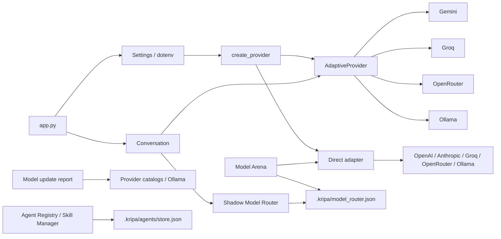
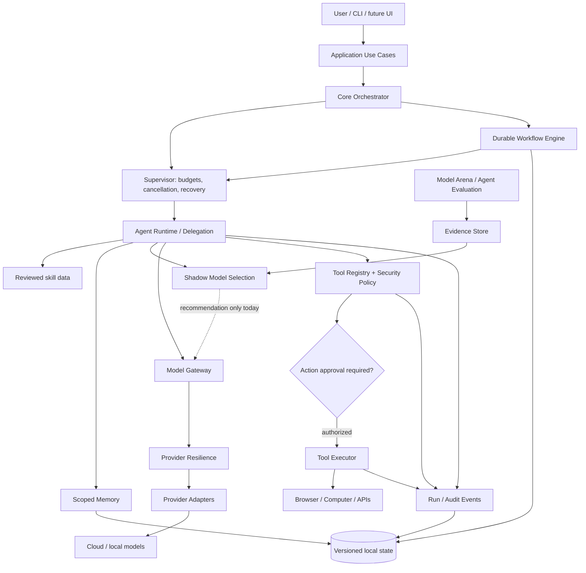

# Kripa Master Architecture Review and Proposal

**Status:** architecture proposal only. No runtime architecture changes are authorized here.  
**Constraints:** Python 3.9 compatibility; the Model Router remains shadow-only; current provider defaults and fallback behavior remain unchanged.

## Executive assessment

Kripa is a single-process Python CLI with modular provider adapters, an evidence-gated shadow router, a repeatable model evaluation harness, model catalog reporting, and an initial Agent Manager for definitions and local instruction-only skills. It is a useful modular assistant foundation, but it is not yet an agent runtime: there is no tool executor, persistent memory, workflow runner, scheduler, delegated-agent runtime, durable supervisor, or browser/computer integration.

The recommended target is a **modular monolith**, not eleven services. Keep the working adapters, fallback, Arena, shadow router and Agent Manager. Add typed application orchestration and security boundaries around them incrementally. Separate *model selection* from *provider resilience*: the router may eventually select a model, while `AdaptiveProvider` handles failures on an execution path. Keep production routing and fallback unchanged until a separate change is approved.

## A. Current architecture

### Components

| Component | Current responsibility | Current state |
|---|---|---|
| `kripa/app.py`, `kripa/__main__.py` | CLI dispatch and interactive chat composition | Manual command dispatch; synchronous process |
| `kripa/config.py` | Immutable settings from environment and `python-dotenv` | API keys passed in memory to adapters; `load_dotenv()` is not explicitly anchored to project root |
| `kripa/engine/conversation.py` | Validate prompt, retain turns, call provider, append successful response | In-memory session only; failed turns do not enter history |
| `kripa/engine/factory.py` | Construct selected adapter | Gemini default wraps current adaptive fallback; other providers are directly selected |
| `kripa/engine/adaptive_provider.py` | Gemini connectivity check and per-turn Gemini → Groq → OpenRouter → Ollama fallback; retry Gemini next turn | No shared retry budget, cancellation, circuit state, or durable health record |
| `kripa/engine/providers/*` | Provider API adapters with a common `reply(messages)` convention | Gemini, Groq, OpenRouter, Ollama, OpenAI, Anthropic; SDK and usage behavior remains adapter-specific |
| `kripa/system_instruction.py` | Shared Kripa identity and runtime provider/model disclosure | Used by adapters; prompt text is not an authorization boundary |
| `kripa/engine/usage.py`, `errors.py` | Normalize explicit usage and provide safe provider errors | Usage coverage varies by provider; error taxonomy is not fully normalized |
| `kripa/model_router/*` | Task classification, candidate/evidence checks, availability refresh and status report | Shadow-only; no effect on the provider used for a response |
| `kripa/model_arena/*` | Fixed prompts, three runs by default, deterministic checks, timing/consistency/usage, leaderboard | Direct provider calls; live requests can incur cost; aggregate results are saved through the router store |
| `kripa/model_updates/*` | Read-only catalog and local Ollama model update report | Explicit command can make catalog requests; it does not install or select models |
| `kripa/agent_manager/contracts.py` | Typed contracts for agents, runs, skills, tools, approvals, workflows | Data structures only unless there is an explicit manager/runtime |
| `kripa/agent_manager/store.py` | Versioned JSON under `.kripa/agents/store.json`; atomic replace and restrictive file modes | Whole-file snapshot; no inter-process locking, backup, or migration framework |
| Agent `registry.py`, `cli.py` | Create/list/view/update/retire agent definitions | Metadata lifecycle, no execution |
| `agent_manager/skills/*` | Local discovery, manifest checks, inspection, digest-confirmed install, enable/disable/remove | `skill.json` + `SKILL.md` only; no skill code is run |
| `tests/*` | `unittest` tests with fake SDK clients/local fixtures | Good unit coverage; no full agent run, approval-gated tool, restart/resume, or end-to-end runtime |

### Communication paths



`Conversation.send()` evaluates the shadow router defensively, then calls its existing provider. Arena deliberately bypasses adaptive fallback to compare providers directly. Arena aggregates feed router benchmarks; availability and verified capabilities are separate evidence. Agent definitions and skills use a separate local store.

### Dependencies and limitations

Runtime dependencies are limited to `python-dotenv`, official provider SDKs (Google GenAI, Groq, OpenAI, Anthropic), and the standard library. OpenRouter uses the OpenAI SDK; Ollama and local JSON use the standard library. No web framework, task queue, agent framework, database, browser automation package, vector store or sandbox is present. Python 3.9 compatibility is preserved through typing and dependency markers.

Provider adapters share a convention, not a formal protocol. Timeouts, continuation, error mapping and usage reporting differ. Gemini may retain an interaction ID while `Conversation` also holds local history. The adaptive provider uses a short TCP reachability check and walks fallbacks after broad request failures, including configuration/authentication failures. The router's heuristic classifier and explicit-evidence filters are appropriate for shadow mode; it refuses unknown availability, undeclared capabilities, incomplete/expired benchmarks and missing metrics. Arena uses fixed correctness checks and a bounded AST interpreter for one coding task; generated code is not executed; writing is left for manual review.

The Agent Manager contracts for `AgentRun`, `ToolDefinition`, `Approval` and `WorkflowDefinition` do not mean those runtimes exist. Skill digest confirmation authorizes registration of the reviewed content only. It does not make the content trusted or authorize external actions. Skill security checks are heuristics; instructions remain untrusted model input and may contain prompt injection.

There is no durable chat memory: conversation messages are process-local. There is no executor, browser/computer access, workflow engine, scheduler, background worker, approval decision service, run/audit stream, restart recovery or backup/restore operation.

### Architectural issues and technical debt

- CLI registration is handwritten in `app.py`; formats and error policies differ across command groups.
- Dotenv resolution is implicit rather than explicitly rooted at the project directory. This review did not read or modify `.env`.
- Provider constructor/error/usage behavior is not uniform. Normalize before higher-level work depends on consistent provider semantics.
- `AdaptiveProvider` combines reachability and fallback policy; keep it as transport resilience, separate from task/model selection.
- Arena aggregates, benchmark evidence, availability and capability attestations currently share one JSON store. Their provenance and retention needs may diverge.
- Atomic JSON replacement prevents partial files but not concurrent lost updates. The Agent Manager store is suitable for early single-process metadata, not concurrent background run state.
- Skill discovery currently skips invalid child directories rather than returning per-candidate rejection findings.
- A recent offline run in this work session had one existing failure: `test_shadow_router_reports_no_benchmark_evidence_without_changing_execution` expects “no benchmark results,” while the router reports unknown availability first. Tests were not rerun for this review; resolve or explicitly update that regression expectation before relying on a green baseline.

## B. Proposed master architecture

### Boundaries and principles

| Boundary | Responsibility |
|---|---|
| **Core Intelligence / Application** | Normalize user task, own run lifecycle, plan/co-ordinate, produce result; no SDK/storage details |
| **Model Gateway** | Typed provider/model protocol, adapter registry, normalized request/response/error/usage; credentials stay inside provider construction |
| **Model Selection** | Task classification and evidence-based candidate filtering; shadow only until explicit activation approval |
| **Provider Resilience** | Timeout/retry/fallback/circuit policy; initial implementation preserves current fallback chain |
| **Agent Runtime** | Agent definition, explicit bindings, skills/tools, bounded delegation and per-agent limits |
| **Skill & Tool Manager** | Skill provenance/validation/approval; typed tool registry and grant lookup; skills are data, tools are executable capabilities |
| **Security & Approval** | Deny-by-default grants, action risk, exact-action approval, redaction and audit; enforcement lives at the executor boundary |
| **Memory & History** | Scoped working/profile/agent/episodic memory, retention/deletion, and separate execution history |
| **Workflow Engine / Supervisor** | Durable steps, pause/resume, limits, deadlines, cancellation, retries and recovery |
| **External Integrations** | Browser/computer/API/application connectors as narrow least-privilege tools |
| **Evaluation / Learning** | Arena and agent evaluation; propose changes from approved evidence, never auto-mutate live behavior |
| **Persistence / Observability** | Versioned repositories, event transitions, redacted logs/metrics, backup/restore/migrations |
| **CLI / future UI** | Thin presentation over application use cases |

Use one modular Python application with one-way dependencies. Core use cases depend on contracts and repository/provider interfaces. SDK adapters, CLI and local storage implement those interfaces. Do not pass `Settings`, credentials, SDK clients or arbitrary mutable state into agents. Do not make separate services until isolation or measured load requires them.



The dashed router edge is intentional: shadow recommendations do not select today's live provider. The existing configured factory and fallback chain remain the execution path until a separately approved activation.

### Agent execution lifecycle

1. Normalize task and constraints; create a run ID and safe audit event.
2. Supervisor enforces agent enabled state, parent/child bounds, deadlines and budgets.
3. Agent runtime loads only explicitly scoped memory and enabled, approved skills. Skill text is untrusted context, never executable code.
4. Router evaluates requirements/evidence in shadow mode. Current execution still uses the configured provider path.
5. If a model proposes a tool action, policy validates the tool is enabled and granted, validates strict schema, normalizes arguments, assigns risk and computes an action digest.
6. For sensitive actions, persist a pending approval and pause. Approval is bound to this run, tool, exact arguments/target and expiry. Recheck it immediately before execution.
7. Executor calls a narrow connector; store sanitized result and an audit event. Use idempotency/reconciliation before retrying uncertain side effects.
8. Return result/status; optionally propose memory updates through a separate privacy/retention policy.

Agent CRUD does not execute. Skill install approval does not grant tool authority. Model-generated actions are proposals, never authorization. Pending approvals must survive restart without becoming approved or replaying effects.

### Model selection lifecycle

1. Normalize task category, local-only/data constraints and speed/accuracy/cost preferences.
2. Form candidates from configured models or explicit agent bindings; do not infer capabilities from names.
3. Filter using current availability, explicitly verified capabilities, policy and complete, fresh benchmark evidence.
4. Return recommendation, reasons, confidence and alternatives. Today this is shadow output only.
5. Execute through existing configured provider + adaptive fallback. Do not silently override an explicit model binding.
6. After offline/integration evaluation and separate approval, route through a model gateway. Keep selection and resilience as distinct policies with an explicit fallback allowlist.

### Memory lifecycle

Separate (a) bounded working conversation context, (b) user-approved profile/preferences, (c) private agent memory, (d) episodic references to run summaries, and (e) append-only execution/audit history. History is not automatically model-readable memory. Memory writes need provenance, timestamp, scope, confidence, retention/deletion policy and, where needed, user approval. Retrieval enforces authorization before ranking. Provide export/delete/backup/restore before claiming long-term memory. Avoid raw transcripts and tool output by default. Start with typed records and a repository interface; use standard-library SQLite when concurrent/restartable execution requires transactions. Add vectors only for a measured need.

### Security and approval lifecycle

1. Identify user/agent/run and propagate a correlation ID.
2. Deny if tool unknown/disabled, grant absent, schema invalid, budget exceeded or state corrupt.
3. Normalize exact action arguments and digest. Reject extra fields, unsafe paths/URLs and ambiguous targets.
4. Determine risk from both tool and operation. External messages, purchases, account changes, deletion, private-data access and computer control require human approval.
5. Show the exact action, target, material arguments, scope and expiry. A changed action requires new approval.
6. Recheck grant/digest/expiry immediately before side effect. Record a redacted audit result; support rejection, expiry, cancel, compensation and recovery.

Prompts, the shared system instruction, skill review and environment-based API keys are not runtime permission enforcement. Never provide unrestricted shell/Python execution as a general tool. Browser/computer integrations need isolation and narrow capabilities.

## C. Target repository structure

This is a gradual target, not a mass relocation. Keep current import paths until replacement interfaces have regression coverage.

```text
kripa/
  app.py                         # thin composition root
  config.py                      # settings and secret-provider wiring
  core/                           # use cases, orchestrator, supervisor
  model_gateway/                  # protocol, adapter registry, factory, resilience, providers/
  model_selection/                # contracts, classifier, candidates, evidence, shadow policy
  agents/                         # contracts, registry, runtime, delegation, context
  capabilities/
    skills/                       # manifest, sources, trust, lifecycle
    tools/                        # contracts, registry, policy, approvals, executor, sandbox
  memory/                         # contracts, repository, policy, retrieval, lifecycle
  workflows/                      # contracts, persistence, runner, scheduler
  integrations/                   # browser/, computer/, http/ narrow adapters
  evaluation/                     # model_arena/, agent_eval/, regression/
  model_catalog/                  # current model_updates, moved later
  storage/                        # repositories, sqlite, migrations, backup
  observability/                  # events, redaction, logs/metrics
tests/
  unit/ integration/ security/ e2e/
docs/
```

Keep runtime data under ignored `.kripa/`, currently `.kripa/model_router.json` and `.kripa/agents/store.json`. Before background/concurrent execution, add transactional SQLite and explicit import/migration from these JSON files, with dry-run, verification, backup and rollback. Credentials never enter the data directory.

## D. Component migration map

| Existing component | Decision | Reason / seam |
|---|---|---|
| `app.py`, `__main__.py` | **Keep; refactor gradually** | Preserve CLI. Centralize dispatch as commands grow; make app a composition root, not an orchestrator. |
| `config.py`, `.env.example`, `.gitignore` | **Keep; harden behind settings interface** | Local environment keys are simple. Root `.env` resolution explicitly and validate non-secret settings later; never copy secrets into agent context/storage. No `.env` changes in this review. |
| `system_instruction.py` | **Keep** | Preserve identity; do not treat prompt text as a security boundary. |
| `engine/conversation.py` | **Keep for interactive chat; refactor behind session contract** | Useful working-memory object; do not turn it into workflow/agent orchestrator. |
| `engine/providers/*` | **Keep; put behind Model Gateway protocol gradually** | Isolated SDK-specific behavior is reusable; standardize request/errors/timeouts/usage before moving paths. |
| `engine/factory.py` | **Keep behavior; later use adapter registry** | Existing provider composition seam. Preserve model defaults and selection path. |
| `adaptive_provider.py` | **Keep as Provider Resilience; clarify boundary** | Useful Gemini recovery and fallback. Never repurpose as task router; do not change order without separate approval and regression tests. |
| `engine/usage.py`, `errors.py` | **Keep; extend contracts** | Safe errors and explicit-only cost are good. Normalize transient/auth/timeout types and usage fields. |
| `model_router/*` | **Keep shadow-only** | Strong typed evidence gates; no activation now. Fix the known test/diagnostic-order mismatch and improve provenance/freshness before use. |
| `model_arena/*` | **Keep; extend as evaluation** | Preserve repeatable checks, safe coding interpreter, manual writing review and separation of metrics. No automatic production selection. |
| `model_updates/*` | **Keep; move later under model catalog/diagnostics** | Read-only catalog feature is useful and independent of runtime selection. |
| `agent_manager/contracts.py`, `store.py` | **Keep; harden before concurrent runs** | Reuse contracts and atomic JSON for early metadata; add migrations, backup and concurrency strategy before workflow state. |
| Agent registry/CLI | **Keep; evolve as Agent Catalog** | Completed CRUD is useful. Add versioned audit events and cross-reference checks as runtime appears. |
| Skill manager/security/source | **Keep; refine trust/reporting** | Good local non-executable foundation. Add per-candidate rejection reasons, provenance, rollback and prompt-injection controls. |
| `AgentRun`, `ToolDefinition`, `Approval`, `WorkflowDefinition` | **Keep; implement services before use** | Schemas exist; state machines, policy, executor/repository do not. |
| `tests/*` | **Keep; add layers** | Preserve mocked unit regression coverage; add policy, integration, security, recovery and E2E gates. |
| `README.md`, `requirements.txt` | **Keep; update per approved phase** | Document actual behavior; avoid framework dependencies without demonstrated need. |
| No memory/tool/workflow/integration/supervisor code | **Add modules; no replacement** | There is no working implementation to migrate. |

## E. Implementation roadmap

### Completed work to reuse

- **Agent Manager Phase 1:** typed agent/run/skill/tool/approval/workflow contracts; versioned atomic JSON store under `.kripa/agents/`.
- **Phase 2:** agent create/list/view/update/retire lifecycle.
- **Phase 3:** local skill discovery, manifest validation, inspection, digest-confirmed install, versioning, enable/disable/remove, source interface.
- **Model Router phases 1–3:** contracts, shadow evaluator, Arena data integration, explicit capabilities and cached availability. Keep shadow mode.
- **Model Arena v2:** repeated task evaluation, separate quality/speed/consistency/cost, manual writing review and bounded code interpretation.
- **Provider work:** isolated adapters, shared Kripa identity, Gemini-first adaptive fallback.

### Required before Phase 4

1. Approve architecture boundaries before execution work; this document itself changes no runtime behavior.
2. Re-establish the offline baseline and resolve the known Router test expectation (or document the intended diagnostic-order contract). No router behavior change is proposed here.
3. Define data backup/restore and schema evolution before storing actual run history or memory; current JSON writes are not concurrency-safe.
4. Specify provider and repository protocols; keep the current configured factory/fallback behind them.
5. Agree on tool risk classes, principals/grants, approval state machine, audit/redaction and fail-closed behavior.
6. Clarify that skill digest approval means “register this exact content,” not “trust or execute this content.” Improve discovery rejection diagnostics.

### Phases and dependencies

| Phase | Scope / exit gate | Depends on |
|---|---|---|
| **4. Tool Registry and non-executing policy** | Declarative tool registry, schema validation, agent grants, risk classification, exact-action approval state and audit contracts. No invocation; unknown/disabled/ungranted actions deny. | Phases 1–3, approved architecture, understood green baseline |
| **5. Single-agent runtime** | One explicitly chosen agent task through existing configured provider path; compose identity and approved skill text; persist run lifecycle. No tools, router activation or provider behavior changes. | Phase 4 contracts, provider protocol, run-store plan |
| **6. Safe tool execution** | One narrow read-only tool through policy and fake executor tests; then sensitive action with pause/resume approval. No unrestricted shell/Python. | Phases 4–5 and security gate |
| **7. Durable memory/history** | Scoped memory, event history, retention/delete/export, backup/restore; SQLite migration when restart/concurrency requires it. | Run contract, privacy policy, migration plan |
| **8. Supervisor/delegation** | Bounded children, depth/call/time/token budgets, cancellation, error-class retries, idempotency and traced parent/child runs. | Phases 5–7 |
| **9. Workflow/scheduler** | Persisted DAG steps, checkpoints, approval waits, pause/resume/cancel/recovery; scheduler only after idempotency. | Supervisor and durable history |
| **10. Model evidence and agent evaluation** | Agent evaluation and evidence provenance/freshness; compare configured bindings with shadow recommendations. No automatic capability or model changes. | Stable gateway and run history |
| **11. External integrations/proactive work** | Narrow browser/computer/API tools, then approved reminders/schedules with revocation, audit and isolation. | Tool security, workflow persistence, supervisor, backups |
| **12. Controlled learning/route activation** | Proposed, versioned changes from approved evaluation; regression gate, human approval and rollback. Router activation is a separate explicit decision. | Governance and all evaluation/security gates |

Phases 4–6 intentionally precede broad delegation, computer control and proactive automation. Phase names may be adjusted to project naming; dependency gates should not be skipped.

### Exact first implementation task after approval

Implement **Phase 4A: a non-executing Tool Registry and Tool Policy service** in a new isolated module. It should register and inspect `ToolDefinition`s without loading callables; accept agent/tool/run/normalized arguments; validate enabled state, schema and explicit grant; return typed Allow/Deny/RequiresApproval with canonical digest; persist approval transitions bound to that action and expiry; and emit redacted audit decisions. Unit tests use fake storage and prove no callable/provider was invoked. This consumes existing contracts, adds no execution path, and does not change provider/config/router behavior.

## F. Risks and mitigations

| Risk | Mitigation / gate |
|---|---|
| Prompt injection in skills, memory, web pages or tool output | Treat as untrusted data; enforce structured executor-side policy; scope and label tool results |
| Skill review confused with execution consent | Separate install digest confirmation from per-action approval |
| Stale/weak router evidence | Keep shadow; provenance and TTL; explicit capabilities; fail closed; never infer capability from score |
| Fallback masks auth/configuration faults | Preserve current behavior initially; normalize failures and safely report primary/fallback outcome before changing policy |
| Agent delegation increases cost or loops | Depth/child/call/time/token budgets, cycle detection, cancellation and cost ceiling |
| Side effect repeated after crash | Idempotency key, action journal, uncertain-outcome reconciliation and compensation |
| Concurrent JSON updates lose state | Keep JSON for single-process metadata; transactional database before concurrent workers |
| PII/secrets in logs, memory or tool outputs | Redact/minimize, scope access, retain/delete/export controls; no raw SDK headers |
| Skills evade heuristic scanner | Scanner is not a trust claim; human review, provenance, no code execution, runtime prompt-injection controls |
| Migration damages local evidence | Backup, dry-run, checksums/counts, read-only old store and rollback |
| Live tests spend money or access production settings | Isolated temp settings and fake clients by default; opt-in smoke tests only |

## G. Testing strategy

### Unit

- Provider protocol/request/error/timeout/usage conformance with mocked SDKs.
- Contracts, JSON migration, duplicate IDs, manifest/path/symlink/size validation, digest and redaction.
- Router unknown/unavailable, missing capability, expired/incomplete benchmark, local-only, metrics and shadow-no-effect assertions.
- Arena correctness, failure accounting, cost provenance and no execution of generated code.
- Tool schema/grants/deny-by-default, approval exact digest/expiry/replay and audit redaction.
- Memory scopes/deletion/retention and no cross-agent retrieval by default.
- Workflow transitions, idempotency, budgets, timeout/cancel and resume.

### Integration

- Mocked provider factory and current fallback/recovery, no live network.
- Agent definition → skill composition → model gateway → durable run event (no tools initially).
- Approved/rejected/expired/changed action through fake executor; prove only exact approval executes.
- Import current JSON stores using temporary copies, with no access to real `.env` or user state.
- Restart between workflow steps and while awaiting approval; no duplicate effect.

### Security

- No credential in exceptions, CLI, traces, memory or serialized definitions.
- Traversal/symlink/oversized/malformed skill tests; never import/evaluate/execute skill files.
- Prompt-injection fixtures in retrieved text and tool results cannot bypass policy.
- Extra fields, unsafe paths/URLs, changed digest, approval replay/expiry, unauthorized agent.
- Parser fuzz/property tests and dependency/secret scans in CI when appropriate.

### Regression and E2E

- Preserve provider default/direct selection, Gemini → Groq → OpenRouter → Ollama order, recovery, history and identity.
- Preserve Router shadow-only status and Arena persistence; preserve Python 3.9.
- Preserve model update report and existing offline tests; settle the known Router assertion mismatch before declaring a green baseline.
- E2E on temporary state with fake providers: task, one safe tool, pause/approval, restart, result and audit retrieval; backup/restore and rollback.
- Real provider/integration smoke tests are opt-in, isolated, sanitized, clearly chargeable, and never run automatically in CI.

## Review conclusion

Preserve current provider adapters/fallback, shared identity, Arena, shadow router, model report, Agent Registry and local skill manager. They are useful and should be surrounded by interfaces rather than replaced. Add orchestration, permission enforcement, tool execution, durable memory, supervisor/workflows and integrations as new modules. The first approved coding task should be the **non-executing Tool Registry and Tool Policy service**, after a confirmed test baseline and agreement on approval/audit semantics. No Phase 4 runtime implementation was started.
